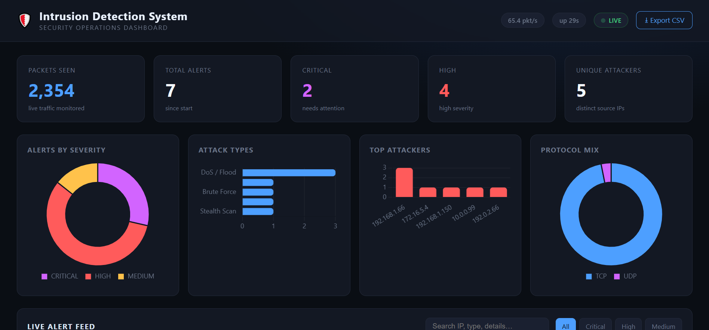
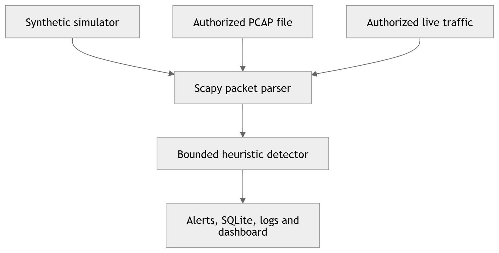

<div align="center">

# 🛡️ PacketSentinel IDS - Network Monitoring

A Python intrusion-detection prototype that processes safe synthetic traffic, authorized PCAP files, or authorized live packets; applies bounded sliding-window heuristics; and presents alerts through SQLite, logs, CSV export, and a local Flask dashboard.


</div>

---

## 📌 Project Overview

**PacketSentinel IDS** is a compact, explainable network-monitoring and alerting prototype built for a junior Python portfolio. It demonstrates how Python can normalize packet metadata, retain recent events in bounded sliding windows, identify suspicious patterns, persist alerts, and display useful results without requiring a production SIEM or machine-learning model.

The normal quick start uses a **local synthetic simulator**. It requires no administrator rights, performs no live capture, sends no attack traffic, and exercises the same detector used by PCAP and live modes.

PacketSentinel supports three explicitly separated inputs:

- **Safe simulation** for demonstrations and automated verification
- **Streaming PCAP replay** for captures the operator is authorized to inspect
- **Opt-in live capture** for networks the operator owns or has permission to monitor

---

## ✨ Features

### 🔍 Explainable Detection

- Eight transparent, configurable heuristic alert categories
- Sliding time windows implemented with capped `deque` histories
- Deterministic limits for tracked sources, retained events, and cooldown entries
- Incremental inactive-state cleanup instead of a full state scan per packet
- Predictable handling of boundary and out-of-order timestamps
- Duplicate-port protection for port-scan counting
- Safe rejection of malformed or missing packet fields
- Cooldown-based duplicate-alert suppression

### 📦 Packet Input

- Safe synthetic simulator as the default source
- Scapy parsing for IPv4 TCP, UDP, and ICMP metadata
- Streaming PCAP replay through `PcapReader`
- PCAP packet-count, file-size, and processing-time limits
- Opt-in authorized live capture with interface selection
- Optional Windows loopback capture when Npcap is available

### 🚨 Alert Handling

- Colored terminal alerts
- UTF-8 text logging to `alerts.log`
- Parameterized SQLite persistence in `ids.db`
- Thread-safe, configurable in-memory retention cap
- Candidate MITRE ATT&CK context clearly labeled as possible mapping
- Detection continues safely if logging or database persistence fails

### 🖥️ Local Dashboard

- Localhost binding to `127.0.0.1` by default
- Unauthenticated dashboard restricted to loopback (`127.0.0.1` or `localhost`)
- Live packet, protocol, severity, attack-type, and source statistics
- Searchable and filterable alert table
- Chart.js visualizations
- Empty-state support
- Formula-safe CSV export

### 🛡️ Safety Controls

- Simulator performs no network activity
- Automated tests require no network access or administrator rights
- `attack.py` is inert by default
- Active private-lab checks require a literal loopback/RFC 1918 IPv4 address
- Domains, public IPs, TEST-NET targets, multicast, link-local, reserved, and unspecified targets are rejected
- Active checks require an exact authorization acknowledgement and enforce conservative caps
- The repository includes no real target, credential, secret, or packet capture

---

## 🖼️ Screenshots

| Dashboard |
| --- |
|  |

| Project architecture |
| --- |
|  |

---

## 🚦 Detection Rules

| Pattern | Default condition | Severity | Possible ATT&CK context |
| --- | --- | --- | --- |
| Port scan | 15 distinct destination ports from one source in 10 seconds | Medium | T1046 |
| Stealth scan | NULL, FIN, or XMAS TCP flags | Medium | T1046 |
| DoS/flood | 500 packets from one source in 10 seconds | High | T1499 |
| SYN flood | 200 SYN-only packets from one source in 10 seconds | Critical | T1499.001 |
| ICMP flood | 100 ICMP packets from one source in 10 seconds | High | T1499 |
| Brute-force pattern | 20 new connections to a configured authentication port in 30 seconds | High | T1110 |
| Suspicious-port access | Connection to a configured watched service port | High | T1021 |
| Example watchlist match | Source or destination matches an RFC 5737 demonstration entry | Critical | T1071 |

Thresholds, windows, ports, watchlist examples, resource caps, paths, and dashboard settings are centralized and validated in `config.py`.

Possible ATT&CK labels provide analyst context only. They are not definitive attribution.

---

## 🧰 Tech Stack

### Core Python

- Python 3.10+
- Dataclasses and validated configuration
- `argparse`, `threading`, `deque`, `OrderedDict`, `ipaddress`, `csv`, and `sqlite3`
- Locks for detector, alert, statistics, and database operations

### Network Processing

- Scapy 2.5+
- IPv4 TCP, UDP, and ICMP metadata parsing
- `PcapReader` streaming replay
- Scapy live and asynchronous sniffers for authorized capture

### Dashboard and Storage

- Flask 3+
- Jinja HTML template
- Chart.js browser charts
- SQLite alert persistence
- CSV export

### Quality Assurance

- pytest
- 29 automated tests
- Python compilation checks
- Ruff configuration in `pyproject.toml`
- Offline test doubles and generated temporary PCAP fixtures

---

## 📁 Folder Structure

```text
Intrusion-Detection-System/
├── docs/
│   └── screenshots/
│       ├── homepage.png
│       └── mermaid-diagram.png
├── templates/
│   └── index.html
├── tests/
│   ├── test_alerts.py
│   ├── test_attack_safety.py
│   ├── test_dashboard.py
│   ├── test_detection.py
│   └── test_pcap.py
├── alerts.py
├── attack.py
├── config.py
├── dashboard.py
├── database.py
├── detection.py
├── main.py
├── simulator.py
├── sniffer.py
├── stats.py
├── .gitignore
├── LICENSE
├── pyproject.toml
├── README.md
└── requirements.txt
```

The application creates `alerts.log` and `ids.db` at runtime. Virtual environments, caches, logs, databases, and PCAP files are excluded by `.gitignore` and should not be committed.

---

## ⚙️ Configuration

This project does not require a `.env` file, external API key, cloud account, or external data service. Configuration is defined in `config.py`.

Important defaults include:

```text
Dashboard host:        127.0.0.1
Dashboard port:        5000
Alert retention:       1,000 in-memory alerts
Tracker-key limit:     2,048 keys per tracker
Event limit:           1,000 events per key
PCAP packet limit:     100,000 packets
PCAP file-size limit:  256 MiB
PCAP processing limit: 300 seconds
```

Invalid thresholds, windows, ports, retention limits, and PCAP limits fail early with clear configuration errors.

---

## 🚀 Getting Started on Windows

### Prerequisites

- Windows 10 or Windows 11
- Python 3.10 or newer
- Internet access for the initial dependency installation
- Npcap only for authorized live packet capture

WSL, Ubuntu, Docker, Anaconda, Miniconda, and external API credentials are not required for the normal Windows simulator workflow.

---

## ▶️ Create the Environment and Run the Complete Project

Use **Windows Command Prompt (CMD)** from the project root.

### 1. Create the Project-Specific Environment

```bat
cd /d "D:\Resumes\Projects\Python\Projects\Intrusion-Detection-System"

py --version
py -m venv intrusion_detection_env
call intrusion_detection_env\Scripts\activate.bat

where python
python --version
```

After activation, the command prompt should begin with:

```text
(intrusion_detection_env)
```

If the environment already exists, do not recreate it. Activate it with:

```bat
cd /d "D:\Resumes\Projects\Python\Projects\Intrusion-Detection-System"
call intrusion_detection_env\Scripts\activate.bat
```

### 2. Install Dependencies

```bat
python -m pip install --upgrade pip
python -m pip install -r requirements.txt
python -m pip check
```

### 3. Run the Complete Automated Test Suite

```bat
python -m pytest -q
```

Expected verified result:

```text
29 passed
```

Tests use synthetic input, temporary files, Flask's test client, and test doubles. They require no administrator rights and perform no outbound network activity.

### 4. Start the Safe Simulator and Dashboard

```bat
python main.py --simulate
```

Open:

```text
http://127.0.0.1:5000
```

The simulator runs continuously until you press `Ctrl+C`.

`python main.py` is equivalent because simulation is the default mode:

```bat
python main.py
```

### 5. Stop the Project

Press `Ctrl+C` once in the running CMD window.

Deactivate the virtual environment when finished:

```bat
deactivate
```

---

## 🧪 Complete Quality Check

```bat
cd /d "D:\Resumes\Projects\Python\Projects\Intrusion-Detection-System"
call intrusion_detection_env\Scripts\activate.bat

python -m pip check
python -m compileall -q alerts.py attack.py config.py dashboard.py database.py detection.py main.py simulator.py sniffer.py stats.py tests
python -m pytest -q
```

Optional Ruff lint check:

```bat
python -m pip install ruff
python -m ruff check .
```

### Dependency Import Smoke Test

```bat
python -c "import flask, scapy, colorama, pytest; print('All project dependencies imported successfully')"
```

---

## 💻 Available Commands

| Command | Description |
| --- | --- |
| `python main.py` | Start the safe simulator and local dashboard |
| `python main.py --simulate` | Explicitly start the safe simulator |
| `python main.py --simulate --no-dashboard` | Run synthetic detection without the web interface |
| `python main.py --pcap PATH` | Stream and analyze an authorized PCAP |
| `python main.py --pcap PATH --no-dashboard` | Analyze an authorized PCAP without Flask |
| `python main.py --live` | Start explicitly authorized live capture |
| `python main.py --live --interface "Wi-Fi"` | Capture an explicitly selected authorized interface |
| `python main.py --host 127.0.0.1` | Run the dashboard on loopback |
| `python attack.py` | Perform no network activity and display the safe simulator command |
| `python attack.py --help` | Display gated private-lab check options without sending traffic |
| `python -m pytest -q` | Run all 29 automated tests |
| `python -m pip check` | Verify installed dependency consistency |

The dashboard has no authentication and therefore rejects non-loopback bind addresses. Add authentication before adapting it for shared or LAN deployment.

---

## 📦 Authorized PCAP Analysis

Analyze only packet captures you own or are permitted to inspect:

```bat
python main.py --pcap "D:\path\to\authorized-sample.pcap" --no-dashboard
```

To keep the dashboard open after replay:

```bat
python main.py --pcap "D:\path\to\authorized-sample.pcap"
```

PCAP input is streamed rather than loaded as one large in-memory list. Configured packet, byte, and processing-time limits are enforced, and the reader is closed after use.

---

## 🌐 Authorized Live Capture

Live capture is opt-in and must only monitor networks you own or are explicitly authorized to inspect.

1. Install [Npcap](https://npcap.com/#download) on Windows.
2. Select **WinPcap API-compatible Mode** during installation.
3. Open CMD as Administrator if required by the selected interface.
4. Activate the environment and start live mode:

```bat
cd /d "D:\Resumes\Projects\Python\Projects\Intrusion-Detection-System"
call intrusion_detection_env\Scripts\activate.bat
python main.py --live
```

For a specific authorized interface:

```bat
python main.py --live --interface "Wi-Fi"
```

The message `No libpcap provider available` is harmless in simulation mode. It means a compatible capture provider is unavailable for live packet capture.

---

## 🔌 Internal Dashboard Endpoints

These are local Flask endpoints, not external data APIs:

| Method | Endpoint | Purpose |
| --- | --- | --- |
| `GET` | `/` | Render the dashboard |
| `GET` | `/api/alerts` | Return retained alerts, newest first |
| `GET` | `/api/stats` | Return traffic and alert statistics |
| `GET` | `/api/export` | Download alert history as CSV |

The project does not call a Pakistani API, commercial threat feed, cloud AI service, or third-party model API.

---

## 🎯 Project Flow

```text
Safe simulator / authorized PCAP / authorized live interface
└── Scapy packet normalization
    ├── Extract source IP, destination IP, port, protocol, flags, and timestamp
    ├── Ignore unsupported or malformed frames safely
    └── Send normalized metadata to the detector
        ├── Maintain bounded sliding-window histories
        ├── Apply eight explainable heuristic rules
        ├── Suppress repeated alerts during cooldown
        └── Trigger a candidate security alert
            ├── Print a terminal alert
            ├── Append to alerts.log
            ├── Persist through parameterized SQLite
            └── Retain a bounded dashboard view
                └── Flask serves tables, charts, statistics, and CSV export
```

---

## 📊 Understanding Results

Example simulator output:

```text
Type    : SYN Flood
Source  : 172.16.5.4
Info    : 200 SYN packets in 10s
Possible MITRE: T1499.001 Direct Network Flood
```

This means the detector observed 200 SYN-only packet events from one synthetic source inside the configured ten-second window. It crossed the SYN-flood heuristic threshold and generated a critical alert.

The result is evidence that a configured pattern matched. It is not definitive proof of a real attacker, identity, intent, or MITRE technique. A human analyst would validate the alert using broader network context.

Repeated simulator alerts are expected after the configured cooldown expires. Runtime results are written to `alerts.log` and `ids.db`.

---

## 🗃️ Data Used

### Safe Simulator Data

The normal demonstration generates fictional packet metadata locally. It uses private-network examples and RFC 5737 documentation ranges, including addresses such as:

```text
192.168.1.66
10.0.0.99
172.16.5.4
192.0.2.66
198.51.100.10
203.0.113.8
```

### Operator-Supplied Data

- Authorized PCAP files supplied by the operator
- Authorized live packet metadata when `--live` is explicitly selected

No PCAP file, real target, credential, personal record, confidential packet, or production threat-intelligence dataset is included.

---

## ⚠️ Scope and Limitations

- Detection is heuristic and can produce false positives and false negatives.
- Possible MITRE mappings are contextual suggestions, not definitive identification.
- The dashboard has no authentication, HTTPS, user accounts, roles, or tenant isolation.
- The Flask development server is appropriate for a local portfolio demonstration, not production deployment.
- The example watchlist is synthetic and has no operational threat-intelligence value.
- IPv6-specific analysis is not included.
- Payload inspection, TLS decryption, signature feeds, anomaly models, and machine learning are not included.
- SQLite and in-process threads suit this bounded prototype, not distributed enterprise traffic.
- Live capture depends on operating-system permissions and a compatible capture provider.
- Use synthetic data or authorized, non-confidential captures for public demonstrations.

---

## 🧑‍💻 Author

**Muhammad Ali Nawaz**  
Python Developer

---

## 📄 License

This project is licensed under the [MIT License](LICENSE).

---

<p align="center">
  <b>⭐ If this project helps you, consider starring the repository!</b>
</p>
